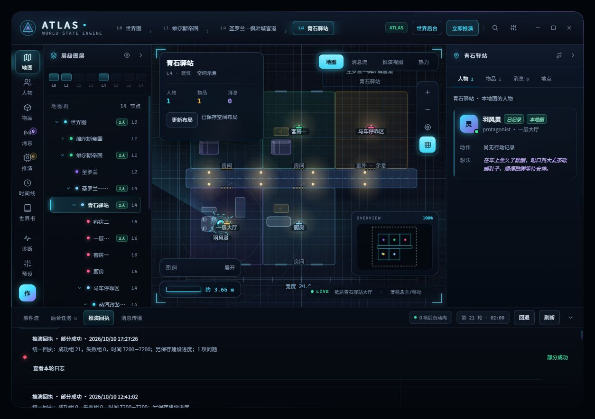

# 主连接流式响应、聊天尾部注入与提示词修复验收

日期：2026-10-10。基线：644adb0，分支 codex/host-main-and-lore-input-fixes。

## 修复

- 主连接使用酒馆当前的 stream_openai 设置，并触发 CHAT_COMPLETION_SETTINGS_READY。已经构造好的 ATLAS 来源不再次进入正文提示词/EJS 组装。
- 完整组装 SSE 正文及函数名、参数片段，兼容网关改写为普通 JSON 的响应。流未结束、格式错误、明确审核或长度截断均不提交；不额外补发请求。
- 所有临时注入及清空统一使用 IN_CHAT、depth=0、SYSTEM。官方本地常量 IN_CHAT=1；修复此前 position=2、depth=4 的错误。
- 加强内置世界、场景、空间和后台策略：明确地点覆盖、真实父链、移动载具锚点、不同场所的功能陈设、分批建设剩余任务披露。
- 本地新增“ATLAS 完整世界与空间策略 20261010”副本，共 12 段（新增策略 6 段 + 原预设 6 段），绑定初始化、推演、纠错。原预设逐项 JSON 比较完全保留，三个任务的 API 连接未改变。

## 验证

- npm run typecheck：通过。
- 九个相关测试文件：94/94 通过，包括流式分片、UTF-8、网关函数包装、原生 Google、截断、拒绝、错误、取消、非流式回退、注入写入与清空。
- npm run sync、npm run pack：通过。
- 本地已安装；安装目录与 release 中 dist/atlas-ui-core.mjs 的 SHA256 相同。
- 仅使用“Atlas 自动化验收 20260930”中性验收聊天，不使用此前正式角色卡生成。
- 通过酒馆普通消息描述官道旁驿站抵达、大厅、厨房、两间客房及停靠区，实际正文成功显示。插件自动推演，自动建立场所和空间布局；没有使用“更新布局”按钮触发这次布局生成。
- 模型结构诊断：HTTP 200，finishReason=stop，streamed=true，streamComplete=true。保存的四次阶段回复分别有 1704/442/1773/962 字符；均无明确拒绝或截断标记。
- 回执 turn_79c105eac20affc367270384：coreSaved=true、worldChanged=true；22 个组已应用、失败组 0，含 scene_maps 与四组 layout:…:scene。
- 回执仍为 partial：LAYOUT_BATCH_PENDING，1 张地图需后续回合继续。界面已显示驿站连通房间、通道与陈设，并非只有地点散点。

## 限制

- 本次证明中性流程下主连接流式回复与自动地图/布局可用；不能据此断言此前空回复一定由 NSFW 或非流式导致。旧失败没有明确审核标记。
- 网关兼容保留当前 fetch 包装；本次阶段响应为普通正文载体，函数载体分片另由离线测试覆盖。未内置第三方网关。
- 本次未实现完整“分析→组装”两阶段流程或更细的功能/API 分配界面；原有三类任务绑定仍保留。
- 布局预算的剩余任务仍会跨回合处理；未宣称所有地图均在一轮建完。
- 当前为本地修复构建，未合并 main、未推送或发布新版本。
