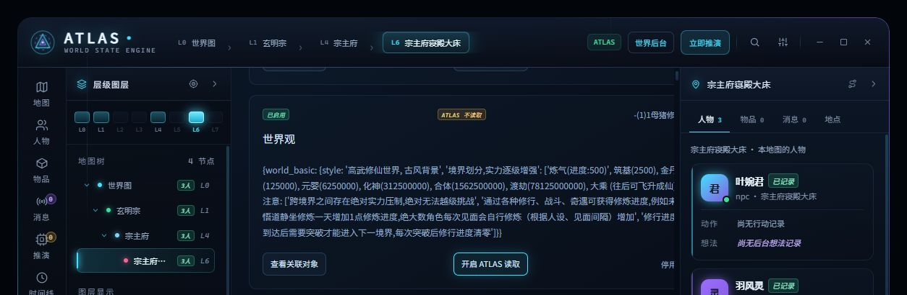

# ATLAS 条目读取开关与空回复排查验收（2026-10-10）

## 已实现

- 世界书页每个条目增加独立的「ATLAS 读取」开关，原有酒馆启停按钮仍单独控制条目启用状态。
- 读取偏好保存于 `extension_settings.atlas_world_sim.excludedLoreEntries`，以世界书名称及条目字典键识别。同一个共享世界书条目的偏好会用于其他聊天；默认全部允许读取。
- 排除规则应用于普通推演、地理/初始化资料选择、直接世界建图和室内布局输入。过滤发生在世界书内容进入选择器之前；仍保留被允许条目的全文，不恢复 6000 字符预算。
- 不调用世界书保存接口，不修改条目正文、启用状态及其他字段。关闭读取不会清除以前已生成的世界状态，也不会删掉普通聊天正文中的相同信息。
- 异步操作结束前校验当前聊天；保存失败回滚读取设置；读取过程中偏好发生变化时丢弃旧结果。

## 空回复证据与结论

原聊天的既有测试于北京时间 12:07:29–12:07:41 执行。四次模型调用分别耗时 4821、1494、2834、2601 ms，宿主 HTTP 状态均为 200，正文均为 0 字符，响应结束原因和审核原因均为空。没有超时，本轮失败且没有提交世界修改。既有控制台记录显示外部网关脚本介入，但没有找到完整回复传输函数。

这些旧日志**不能确认是否为 NSFW 审核拦截，也不能证明输出额度截断**。HTTP 200 只代表酒馆生成端点的状态，不等于供应商返回了有效正文。旧响应正文没有保存，新增诊断不能追溯还原其原因。

资料检查发现涉及未成年角色的露骨内容，因此未再次发送该部分资料进行模型测试，也未绕过内容审核。对照使用已有中性验收聊天，不改动当前主连接；当时模型为自定义端点上的 `gemini-3.7-flash-high`。

北京时间 12:41 的中性对照回执：

- 回合 `turn_300853c2c073b27bb385221e`：`committed`、`coreSaved=true`、`worldChanged=false`，无 issues。
- 两条模型成功诊断均为 `chat-completions-raw` / `main` / HTTP 200 / `finishReason=stop`，各返回 13 字符有效正文。
- `providerErrorKind=none`，无 refusal、无上游 error。结果为无新增世界内容的有效提交，不能把它宣称为新地图与布局生成验收。
- 本次浏览器控制台没有读到网关脚本日志，因此不以这次中性对照额外宣称网关传输函数验收成功。

对照说明当前连接能够正常响应；输入不同，因此还不足以把原聊天空回复归因于内容审核。

## 新诊断

增加结构信息：响应类型、choices/candidates 数、Google parts/思考段/正文段数、正文字符数、拒绝标记、上游错误存在与否。仅保留计数和允许的枚举，不保存提示词、回复、任意错误文字或签名。

明确审核标记归类为 `content-filter`；`length` / `MAX_TOKENS` 归类为 `output-limit`；缺少这两类标记的空回复明确显示原因尚未确定。错误仍不提交模型结果。

## 验证与安装

- `npm run typecheck`、`npm run sync`、`npm run pack` 通过。
- 7 个相关测试文件初次 214 项通过；新增直接建图/布局输入过滤用例后，新文件 5 项通过（其中 4 项已计入前次），共 **215 个不同用例通过、0 失败**。
- 真酒馆 UI 验证：中性「世界观」条目关闭 ATLAS 读取后仍显示酒馆「已启用」；刷新后读取设置保持关闭；该条目完整 JSON 未改变。测试后恢复允许读取，最终排除列表为空。
- 全世界书文件的哈希有变化，聊天加载期间还有其他插件写入，所以不声称整个世界书文件逐字节不变。
- 已部署到本机酒馆扩展目录；安装前备份在 `.tmp/lore-read-control-installed-backup-20261010`。未合并 main、未推送、未发布新版本。

