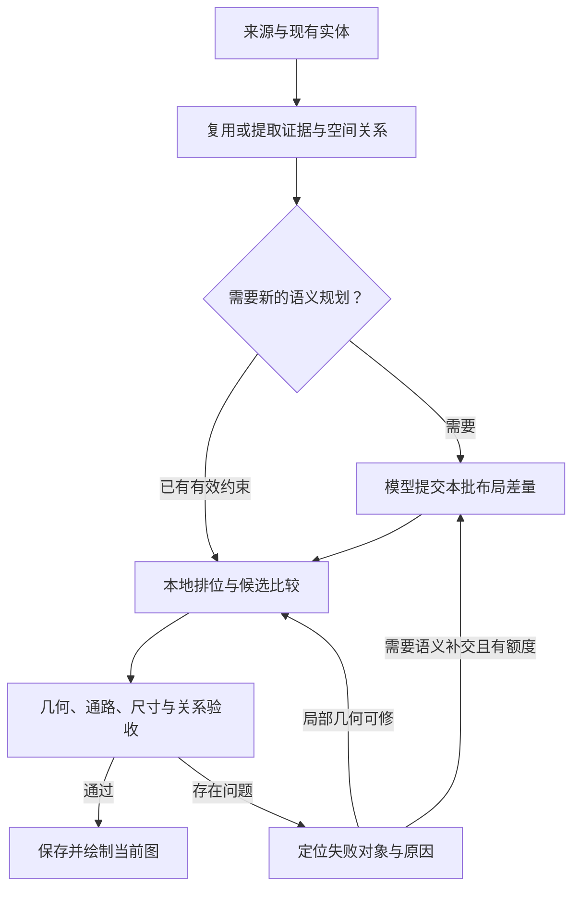

# 提示词、地图生成流程与开源复用审查

日期：2026-10-28。代码基线：`09059b4`，包含 0.9.99 之后的内容容量与父子地图修复。本文为工程审查和后续实施建议；没有安装下面的候选依赖，也没有向外部模型发送效果评测请求。

## 结论

优先统一空间语义、输出契约和质量评测，再替换局部算法。Atlas 已有事务、保存确认、请求预算、批次去重、布局指纹及局部修复，不需要再增加一套调度框架。成熟开源工具最适合接在结构校验、几何运算、空间查询和测试这几层。

本项目当前的地图生成路径主要是“模型提供结构化约束，程序计算坐标和几何，Canvas 绘图”。美术素材工具是另一条路径。地图结构正确、入口可达和父子尺寸一致，需要在程序几何层保证。

## 代码已具备的能力

| 能力 | 当前入口 | 审查结论 |
| --- | --- | --- |
| 提示词三层 | `src/atlas-prompt-layers.ts` | 已区分协议、用户策略和任务上下文；保留这项设计，减少不同位置重复描述同一规则 |
| 资料摘录 | `src/atlas-layout-evidence.ts` | 已有来源哈希、原文偏移及片段编号验证；当前主要选择原句，没有结构化空间关系 |
| 请求账本与额度 | `src/atlas-sql-generation-budget.ts`、`src/atlas-model-call-audit.ts` | 已统计实际发送、兼容重发和工作类别；优先使用现有逐轮分析定位问题 |
| 布局指纹 | `src/atlas-layout-signature.ts` | 已按每张图判断结构变化，并排除普通人物移动；不应重新实现相同缓存 |
| 局部候选与通路检查 | `vendor/atlas-spatial/layout-core.mjs`、`room-topology.mjs` | 已有房间共墙、通路、部分候选和门位置尝试；应扩大可表达关系和候选选择能力 |
| 尺寸与身份 | `src/atlas-space-canonical.ts`、`src/atlas-layout-closure.ts` | 已有尺寸权威账本和跨父子图一致性闭合；开源组件通过适配器消费这些事实 |
| 地图质量 | `src/atlas-map-quality.ts`、`atlas-map-assessment.ts` | 已有覆盖、几何、通路与尺度检查；下一步增加“原文空间关系是否满足”的验证 |
| UI 实验台 | `tools/map-lab/README.md` | Leaflet / markercluster 已用于实验台和测试；正式 UI 仍为 Canvas，原型并非已完成的替换 |

## 优先级一：提示词与输出契约

### 1. 对齐新的父子地图与相对排位规则

`src/atlas-sql-layout-task.ts` 仍有“程序从父到子求解坐标、继承轮廓”“相邻街区维持父图的相对方位”等文字。父图足迹、尺寸权威与子图局部坐标需要明确区分，避免模型把父图上的远方兄弟也视为当前图的绘制对象。

现有 overview 说明列出 `near`、`sector`，但没有明确二者同时存在时方向相对谁。此次核心已修正相对排位，任务提示词也应同步明确。这是本轮发现、建议首先处理的文案问题，尚未修改运行时提示词。

可替换的任务说明草案（只使用当前已实现字段）：

> 本批地图按已有父子归属分别提交约束，每张图使用自己的局部坐标系。父图中的足迹为子空间提供尺寸依据；spaceSize 与 childSpaces 的权威尺寸保持一致。相邻空间在它们共同的父图表达，当前子图只细化自己负责的内容。overview 中 near 指定参照地点；同时提供 sector 时，方向相对该参照地点，例如 near=B 且 sector=south 表示在 B 的南侧附近。没有 near 时，sector 表示本图方位。方向和示意间距不构成实测距离。沿用已有实体和局部陈设 ID，提交本次需要的差量。

内置策略调整时递增内置目录版本，通过现有预设升级机制提供建议；用户另存的预设保持其身份和编辑内容。预览与真正发送继续共用同一组装链。

### 2. 把格式约束交给同一份 schema

`src/atlas-sql-model-port.ts` 当前函数输出的参数是 `{content: string}`，字符串内部仍然包含 JSONL。工具外壳能约束参数名，不能直接约束字符串中的每条操作、枚举或必需字段。

建议将操作契约定义为一份 schema，派生：

- 提示词中的字段说明、合法示例与当前阶段允许操作。
- 本地结构校验和准确错误路径。
- 支持结构化参数的连接所使用的工具参数；其他连接保持现有文本协议适配。

先从 `map.layout.request` 的三套 spec 开始，保持现有业务校验负责引用、作者锁、父子尺寸和事务，不重复写另一套世界规则。

候选：[Ajv](https://ajv.js.org/guide/why-ajv.html)。其 [standalone validation](https://ajv.js.org/standalone.html) 可在构建期生成校验函数，运行包按需携带生成结果。是否减小体积要比较实际 schema 数量与 bundle，不能仅凭项目宣传推断。

### 3. 让证据阶段同时表达空间关系

`planLayoutEvidence` 目前让模型返回 `facts: [{mapRef, segmentRef}]`，程序验证并取回原句；后续布局模型仍须从散文里再次理解包含、相邻、方向与入口。

建议沿用同一次证据请求，扩展可校验的关系记录：实体引用、关系类型、证据片段、来源/估计、必须满足/布局偏好。例如“前庭在建筑南边且邻近”应同时留下方向和邻近关系；“相邻”与“有门可通行”分别表达。

先实现关系契约、解析器和求解适配，再在生产提示词中启用新字段。当前三套输入表达不同：overview 使用 sector/near，floor 主要使用 north/south 的 side，city 使用 west/east 的 bank/order。统一关系模型可以减少模型在三套接口之间反复翻译。

## 优先级二：生成步骤与局部修复

建议继续沿用现有阶段，形成以下分工。图中“复用证据”与“关系记录”是后续扩展项，尚未接入：

具体改进：

1. **复用已验证证据。** 当前 `layoutEvidenceCache` 位于一次准备流程内。可将已验证结果按来源内容哈希、地图成员/父子关系、证据策略版本缓存；只重新处理变化来源。以整库 revision 作为唯一缓存键会让普通回合也失效，应避开。
2. **本地问题先本地求解。** 家具碰撞、门被挡、候选位置不佳先使用已有约束尝试本地候选。缺少事实、用途或实体引用时，再在用户额度内请求模型补交。现有代码已有部分候选，这里是扩展而非从零重建。
3. **按失败对象修复。** 已成功地图和已放下的陈设沿用原身份；只回传失败空间、相关约束与准确错误。当前已有 missing-map、format-repair 等路径，后续集中统一其输入契约。
4. **给旧的估计布局提供局部重排。** 此次保存了旧坐标稳定性；已经拉远的旧间距可能继续保留。可先预览指定关系涉及的估计轮廓如何移动，再按同一事务和 ACK 保存；作者确认与锁定结构继续作为固定约束。
5. **增加关系验收。** 当前“能解析、有几何、覆盖齐全”之外，还应检查方向、邻近、包含、入口及可达性是否满足有依据的关系。未知和不支持的关系需要单独报告。

局部候选搜索和模型补交继续使用现有计算预算、请求额度与中止机制；这里不新增自动调用阶段。

## 可以直接复用的开源工具

以下能力已核对官方仓库或官方文档；“接入点”和优先级是针对 Atlas 的工程判断，尚未做性能对比。

| 工具 | 可复用的成熟能力 | Atlas 接入点与取舍 |
| --- | --- | --- |
| [Ajv](https://ajv.js.org/standalone.html) | schema 校验与构建期生成校验函数 | 优先；替代散落的结构字段说明/校验重复，保留业务语义检查 |
| [Promptfoo](https://www.promptfoo.dev/docs/configuration/expected-outputs/javascript/) | 提示词版本比较、自定义 JavaScript 输出断言 | 优先在开发侧接现有解析器与地图检查；评测任务与用户正常生成分开 |
| [fast-check](https://fast-check.dev/docs/introduction/why-property-based/) | 属性测试、可复现 seed、失败输入缩减 | 优先在开发侧生成父子尺寸、门、家具与更新组合，找出固定案例未覆盖的反例 |
| [polygon-clipping](https://github.com/mfogel/polygon-clipping) | 多边形交、并、差、异或 | 适合主空间扣除子空间、非凸边界、洞和裁切；返回 MultiPolygon，需明确适配多片区域与洞，不能压成一个普通点环 |
| [RBush](https://github.com/mourner/rbush) | 点与矩形的空间索引、批量建立与范围查询 | 适合家具碰撞候选、可见范围筛选与标记命中；先基准比较，不能把包围盒相交直接当成精确几何相交 |
| [elkjs](https://github.com/kieler/elkjs) | 节点/边/端口布局及 Web Worker 接口 | 可作为区域、建筑、入口关系的初始候选排位；需要继续由现有米制求解和共墙/门检查生成最终空间 |
| [rot.js](https://ondras.github.io/rot.js/doc/classes/path_astar.default.html) | A* 等路径模块，可传通行判断回调 | 后置候选；现有栅格洪泛已能做连通检查，只有基准显示路径搜索值得替换时再适配 |

`layout-core.mjs` 的候选检查中多次扫描已有物体，栅格通行构造也逐格查询障碍。RBush 可能减少这些查询的候选集合，但真实收益取决于单图密度、索引更新与导航网格成本，尚不能声称会快几倍。

`layout-core.mjs` 和 `overview-core.mjs` 都有多边形包含、裁切或相交辅助函数。可先以统一几何适配器覆盖明确需要的布尔运算，逐步减少重复实现。门、通路、世界事实和米制单位属于 Atlas 业务，成熟几何库不会替我们决定这些语义。

### 大型地图项目：借鉴流程和交互

[Azgaar's Fantasy Map Generator](https://github.com/Azgaar/Fantasy-Map-Generator) 及其[官方知识库](https://github.com/Azgaar/Fantasy-Map-Generator/wiki/Knowledge-Base)可作为宏观地图生成、地形/道路/标注编辑与分层展示的参考。它的世界数据模型与 Atlas 的叙事实体库不同，直接整体移植需要大量适配；从具体算法、编辑交互或标注处理开始更合适。已有世界没有河流依据时，也不能因为生成器自带河流流程就替用户补出一条河。

## 建议的实施顺序和验收

| 后续批次 | 交付 | 主要验收 |
| --- | --- | --- |
| A | 对齐父子地图 / near / sector 提示词，补少量真实合法例子；建立提示词基线 | 预览=真实发送；同一资料、连接和设置重复生成，比较关系满足率与首轮成功率 |
| B | 单一输出 schema；接 Promptfoo 与 fast-check | 文本/工具输出走同一校验；保留既有错误路径；失败组合可复现并缩减 |
| C | 证据+关系契约及增量缓存 | 来源未变时正确复用；来源、成员、父子关系改变时准确失效；不增加固定模型阶段 |
| D | polygon-clipping 与 RBush 的小范围适配原型 | 对比真实几何结果、极端尺寸、孔洞、多片区域、时间和包体；确认锁与保存语义不变 |
| E | elkjs 初始布局候选、旧估计图局部重排预览 | 方位、通路、尺寸与可读性优于同一基线；已确认事实保持不动 |

固定评测案例至少包含：建筑与前庭的邻近/方向、多层住宅、未明确楼层的房间、厨房包含储物间、相邻但没有门、带私密入口限制的房间、无河城市、远方兄弟、父子尺寸冲突、隐藏对象，以及仅更新家具或人物位置。

现有 3030 项回归验证了当前修复的代码行为；它们不等于这些后续方案已经接入，也不等于真实模型生成质量或浏览器像素效果已经通过。本轮不据此作性能或效果提升的百分比承诺。

## 主要官方来源

- Ajv：[设计与使用理由](https://ajv.js.org/guide/why-ajv.html)、[独立校验代码](https://ajv.js.org/standalone.html)。
- Promptfoo：[JavaScript assertions](https://www.promptfoo.dev/docs/configuration/expected-outputs/javascript/)。
- fast-check：[属性测试、缩减与复现](https://fast-check.dev/docs/introduction/why-property-based/)。
- RBush：[官方仓库](https://github.com/mourner/rbush)。
- polygon-clipping：[官方 API、输出结构与算法](https://github.com/mfogel/polygon-clipping)。
- elkjs：[官方 API 与 Web Worker 接口](https://github.com/kieler/elkjs/blob/master/README.md)。
- rot.js：[官方 A* API](https://ondras.github.io/rot.js/doc/classes/path_astar.default.html)。
- Azgaar：[项目](https://github.com/Azgaar/Fantasy-Map-Generator)、[知识库](https://github.com/Azgaar/Fantasy-Map-Generator/wiki/Knowledge-Base)。
