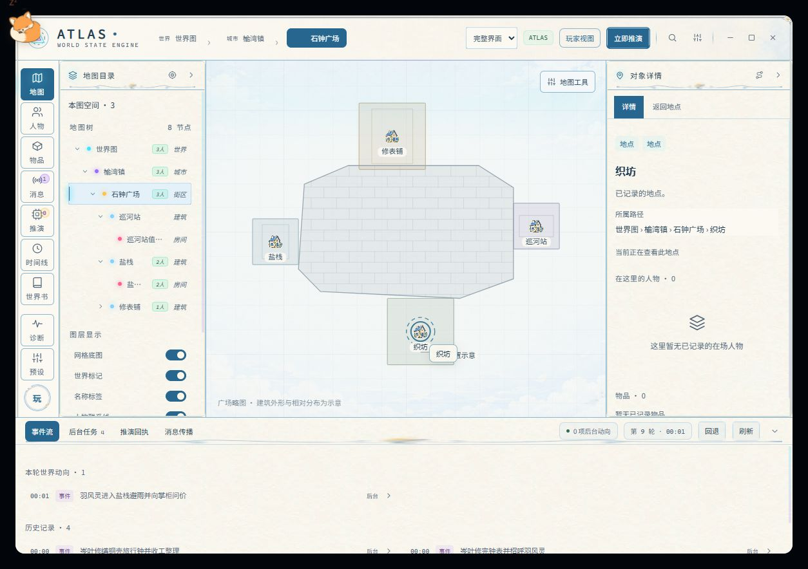
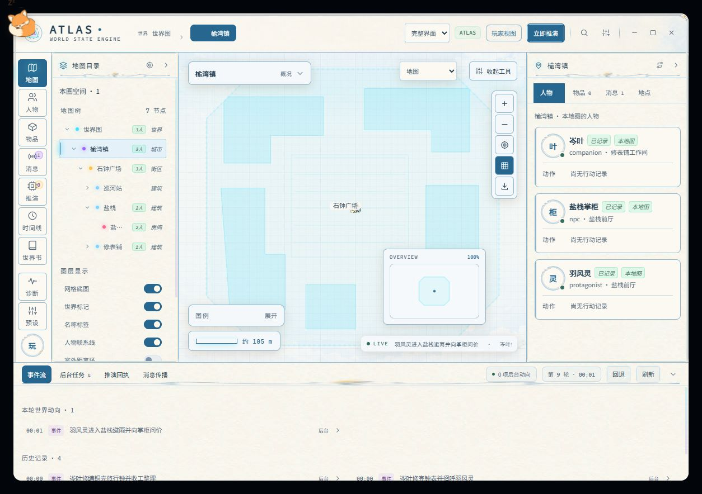
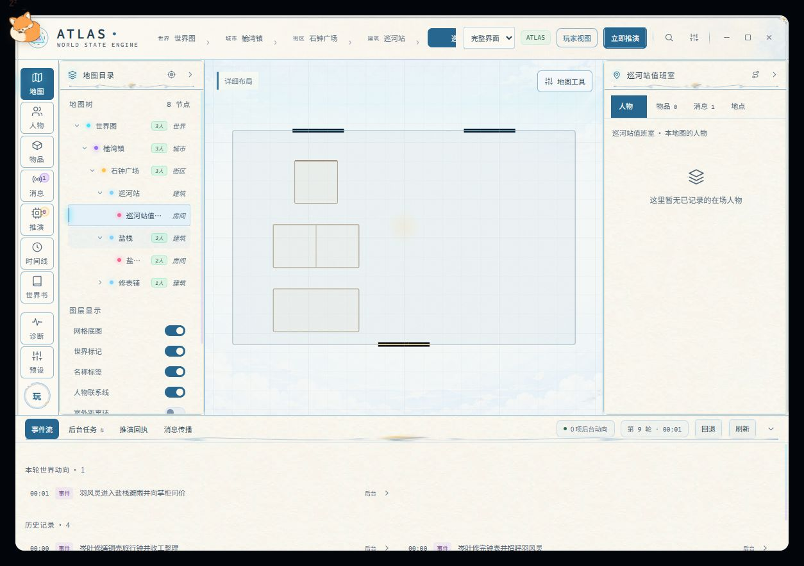

# 广场布局与图签清理：宿主回读验收

## 问题与修正

石钟广场被通用城市组装器生成了 1000×1000 幅面、一个覆盖整幅的自身街区、四栋 24×24 建筑的一排默认坐标，以及 `avenue`/`road:<区域>` 模板道路。画布按整幅取景，导致一根横条、大片空底色和拥挤图标。其上层榆湾镇只有一个已知区域时，同样画出了没有登记路线依据的长条。

- 对未标定、仅一个自身分区、建筑均为默认布局精度且同排的广场模板，改用二维铺地区域及周边地点略图，取消自身大底板和模板道路。
- 使用已有地点身份与图标；有内部图的图标继续进入已有子图，只有外观的地点只打开资料。已有子房间按比例展示粗轮廓，没有内部资料的地点不虚构房间。
- 广场的显示坐标仅用于略图，不回写物理坐标；标明建筑外形及相对分布为示意，不显示数值比例尺。该修正不恢复生成阶段漏存的方位事实。
- 上层只有一个区域、没有登记路线的模板城市，省略默认模板道路；真实/确认道路、标定地图和多区域城市保留。
- 去掉室内画布上重复显示父地点与自身名称的标题框，以及自身边界的重复名称。子房间名称和已有导航栏保留。

保护条件包括确认尺度/轮廓/标记、有登记路线、非默认道路、非默认建筑排布、多街区城市、河道和城墙。之前获认可的多地点城镇画法不套用单广场重排。

## 实际宿主验收

使用内置浏览器在 `http://localhost:8000/`，读取上一项新聊天已保存的榆湾镇、石钟广场、巡河站及值班室，切换玩家/作者视角、导出并比对。

最终安装：源码 `664a24c0c063b285e9a44a2963a60e68f7927d24`，运行归档 `6f3100b`，宿主实际报告 `build-d303205ecf4ecf30`、buildDirty=false。51 个安装文件与 Git 归档逐项哈希一致；旧运行文件已有本地备份。正式 v0.9.100 tag 和发布资产没有变更。

- 广场和上层城镇均没有长条；广场图标分开，显示铺地与已知内部粗轮廓。
- 实际单击巡河站原生图标进入子图，再打开值班室，画布没有重复标题框。
- 实际单击织坊图标打开资料，仍留在广场，没有进入空子图。
- 最终导出与修改前的 8 张城镇及下属地图比对：所有 `scene` 与 `points` 完全相同，scope/revision 不变。修改的是只读 `rendered.geometry`，两层模板道路数均为 0。
- 最终逐轮分析仍为原来的 8 个 requestRef，本次显示修正新增 Atlas 模型调用 0。不能把这次回读写成最终版本的新模型冷启动验收。

这是显示与交互修正。建筑父图的模板走廊、部分父图取景以及生成侧家具与朝向问题仍需进一步改进；没有将所有地图层级声明为通过。

## 补充检查

最终源码全量 **3095/3095**；相关绘图、投影、相机与 UI 测试 **97/97**；类型检查、打包和差异空白检查通过。新增回归覆盖标记身份、子图入口、已知房间比例、未知内部不虚构、默认道路清理与真实道路保护、标题移除且子房间名保留。测试指令替身不冒充浏览器像素验收。

机器汇总：[host-readback-summary.json](local-square-20261101/host-readback-summary.json)。
